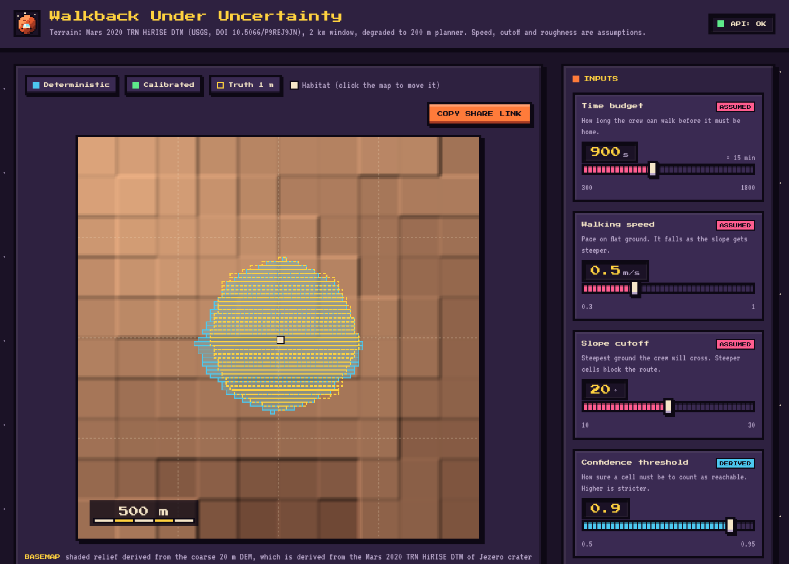
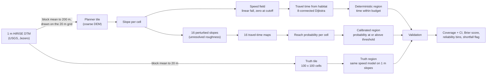
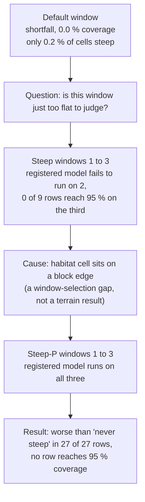
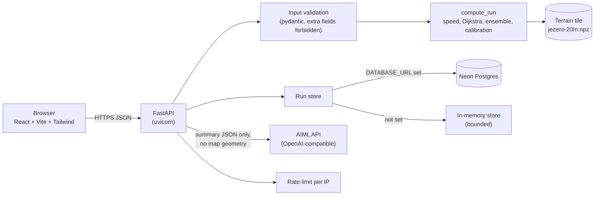
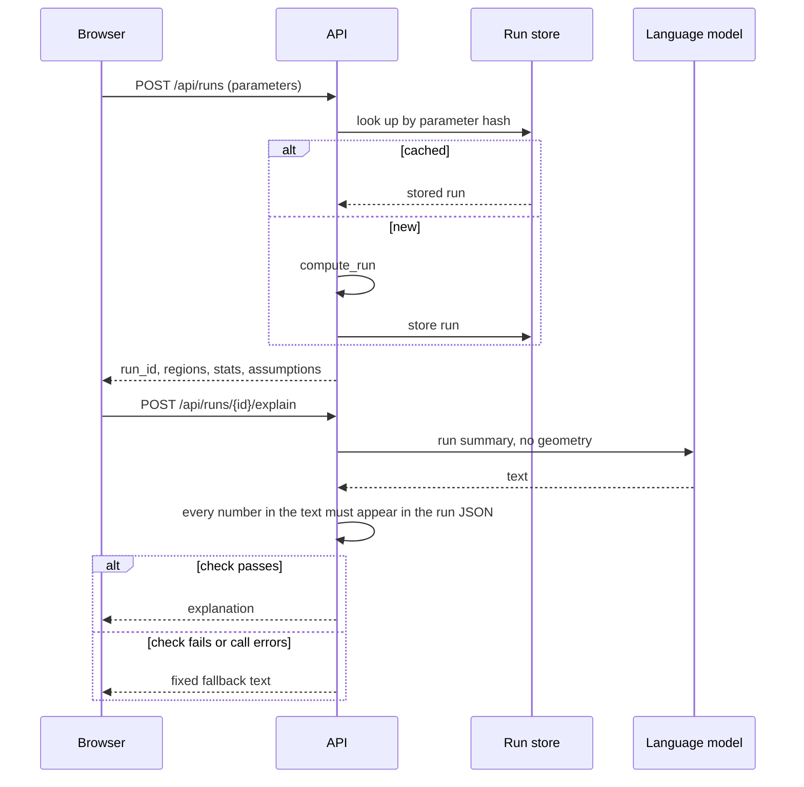

<p align="center">
  
</p>

<p align="center">
  <a href="https://github.com/Eman2123/Walkback/actions/workflows/ci.yml"></a>
  
  
  
  
  
  
</p>

<p align="center">
  <b>For a habitat and an EVA time budget, show the area from which a crew can still walk home, and how much to trust that area.</b><br>
  Predicted from a coarse terrain map, checked against a 1 m HiRISE terrain model of Jezero crater.
</p>

<p align="center">
  <a href="#quick-start">Quick start</a> &middot;
  <a href="#headline-result-a-shortfall-reported-as-one">Headline result</a> &middot;
  <a href="#how-it-works">How it works</a> &middot;
  <a href="#architecture">Architecture</a> &middot;
  <a href="#api">API</a> &middot;
  <a href="#deploy-on-free-tiers">Deploy</a> &middot;
  <a href="#limitations">Limitations</a>
</p>

<p align="center">
  <b>Live demo:</b> <a href="https://walkback-rlvz.vercel.app">walkback-rlvz.vercel.app</a> &middot;
  <b>API health:</b> <a href="https://walkback-eta.vercel.app/api/health">walkback-eta.vercel.app/api/health</a> &middot;
  <b>Code:</b> <a href="https://github.com/Eman2123/Walkback">github.com/Eman2123/Walkback</a>
</p>

---

> **Not flight software.** This is a planning aid built for the NASA Space Apps Challenge 2026. Every speed, slope cutoff and roughness value is an assumption and is labelled as one. No route is declared safe.

## Contents

0. [Demo links and latest changes](#demo-links-and-latest-changes)
1. [The question](#the-question)
2. [Screenshot](#screenshot)
3. [Headline result: a shortfall, reported as one](#headline-result-a-shortfall-reported-as-one)
4. [How it works](#how-it-works)
5. [Validation design](#validation-design)
6. [What the follow-up studies found](#what-the-follow-up-studies-found)
7. [Architecture](#architecture)
8. [API](#api)
9. [Quick start](#quick-start)
10. [Configuration](#configuration)
11. [Deploy on free tiers](#deploy-on-free-tiers)
12. [Data and sources](#data-and-sources)
13. [Pre-registration and claims rules](#pre-registration-and-claims-rules)
14. [Repository layout](#repository-layout)
15. [Limitations](#limitations)
16. [Team, license and credits](#team-license-and-credits)

## Demo links and latest changes

| What | Link |
|---|---|
| Live app (frontend, Vercel) | https://walkback-rlvz.vercel.app |
| API (FastAPI, Vercel), health check | https://walkback-eta.vercel.app/api/health |
| Source code | https://github.com/Eman2123/Walkback |
| 30-second video script | [docs/video-script.md](docs/video-script.md) |

If the API is asleep or unreachable, the app falls back to a recorded demo that says it is synthetic. The first request after a pause can take a few seconds.

**Latest changes (main, 2026-11-15)**

- **Route feasibility** (PR #5): the planner's own route is walked on the 1 m truth. 88.8 % of the 987 calibrated cells have a route that gets home in time (Jezero, v2, roughness 0.5, confidence 0.9). Registered in [PREREGISTRATION.md](PREREGISTRATION.md) before it was run. Report: [reports/route_feasibility.md](reports/route_feasibility.md).
- **Route check card** in the app, reading `web/public/route-feasibility.json`. A fixed report, not recomputed from the sliders.
- **Assumptions panel fix**: long assumptions (start cell, return direction, what is not modelled) now wrap in full-width cards instead of overflowing.
- **Vercel build fix**: a merge had dropped `loadRouteFeasibility` from `web/src/lib/api.js`, which broke one preview build. Fixed in the same PR.
- **API reliability** (PR #4): the client tries the same origin first and retries, which fixed intermittent "API: UNREACHABLE".
- **Model profile v2** (PR #3, the default): habitat cell stays passable and the result is the time to the habitat. Coverage 86.9 %, still below the 95 % target, so it is reported as a shortfall.

The headline stays a shortfall. Nothing in these changes turns it into a pass.

## The question

A crew on foot on Mars needs to know how far from the habitat it can go and still get back inside a fixed time budget (for example 15 minutes of walking). The answer depends on slope, and the best terrain model of a landing area is usually coarse. Steep ground that is invisible at 200 m can slow or block a walk.

Walkback answers two things:

1. **Where** can the crew walk home in time? (a *deterministic* region from the coarse map, and a *calibrated* region that keeps only cells where the walk home succeeds in most of 16 plausible terrains)
2. **How much should we trust that region?** (it is compared with a *truth* region computed from the 1 m terrain model, and the gap is reported, including when the gap is bad)

## Screenshot

<p align="center">
  
</p>

<sub>Real Jezero tile, default setting. The blue region is the deterministic walkback area; the dashed yellow outline is the 1 m truth. The screenshot shows the registered v1 setting, where the calibrated (green) region is empty (the registered shortfall described below); the app now opens in profile v2. The blocky relief is the 200 m planner terrain, not an image of Mars.</sub>

**Sound (optional).** The header has a *Sound* switch, **off by default**. When on, the app plays short 8-bit beeps generated in the browser (no audio files): clicks, slider ticks, a descending tone when a result misses the 95 % target (so a shortfall never sounds like a win), and a buzz on errors. The *Listen* button under the explanation reads it aloud with the browser's built-in voice (English only; voices differ by browser). Turning sound on also reads each new explanation aloud. The setting is remembered per browser.

## Headline result: a shortfall, reported as one

The default setting was registered before the result was known. It **does not meet the 95 % coverage target**, and that result is kept as registered.

| Quantity (default setting) | Value | Label |
|---|---|---|
| Habitat cell | row 50, column 50 of a 100 x 100 grid | assumed |
| Time budget | 900 s | assumed |
| Walking speed on flat ground | 0.5 m/s | assumed |
| Slope cutoff | 20 degrees | assumed |
| Unresolved roughness | 0.5 | assumed |
| Confidence threshold | 0.9 | derived |
| Deterministic area | 0.444 km² | derived |
| Calibrated area | 0.000 km² (empty) | derived |
| Truth area (1 m) | 0.422 km² | derived |
| **Coverage of the truth** | **0.0 %** (95 % CI 0.0 % to 0.4 %) | derived |
| Brier score | 0.0157 | derived |

**Registered result (profile v1) and the default of the app (profile v2).** The table above is the registered model, kept as it was registered. The app and the API now run **profile v2**: the same model with the habitat cell kept passable in every realization (the crew starts inside it) and the result stated as the time *to* the habitat. Registered before it was implemented, see [PREREGISTRATION.md](PREREGISTRATION.md). On the same setting:

| Default setting, Jezero tile | v1 (registered) | v2 (app default) |
|---|---|---|
| Calibrated area | 0.000 km² | 0.395 km² |
| Coverage of the truth (95 % CI) | 0.0 % (0.0 % to 0.4 %) | 86.9 % (84.7 % to 88.8 %) |
| False reach | not defined (empty region) | 7.3 % |
| Brier score, no-skill Brier | 0.0157, 0.0020 | 0.0157, 0.0020 |

v2 is **still a shortfall** and does not touch the Brier problem below. It removes a modelling flaw (a crew that starts at the habitat was not allowed to "reach" it), not the terrain problem. The v2 numbers on this window were known from the post-hoc diagnostic before v2 was written, so they are not a prediction, and v2 has not been tested on the steep windows.

**Why the registered calibrated region is empty.** A post-hoc diagnostic ([reports/start_cell_diagnostic.md](reports/start_cell_diagnostic.md)) shows that the habitat's own cell is perturbed and blocked in 12.5 % of the 16 realizations, so no cell can reach a 0.9 reach probability. With the start cell kept passable the same setting gives 86.9 % coverage, which is still a shortfall. We report both numbers, labelled, and we do not pick the best setting as the headline.

**Why the Brier score looks worse than it is, and what we did about it.** The planner terrain is a staircase of 100 constant 200 m blocks, so slope on the 20 m grid is exactly 0 inside a block and large only on block edges. Only 0.2 % of the 20 m truth cells reach the 20 degree cutoff in this window, so a forecast that always says "never steep" scores 0.0020, better than the registered model's 0.0157. A variant that computes slope on the 200 m block grid (`grid200`) reaches that no-skill level, but this first window cannot tell a good planner from a poor one. That is why we looked at steeper windows (below). Details: [reports/planner_slope_variant.md](reports/planner_slope_variant.md).

## How it works



**Speed model (assumed).** Speed falls linearly with slope from the flat-ground speed to zero at the slope cutoff. A cell at or above the cutoff is impassable. These are assumptions, not measurements.

**Travel time.** Dijkstra on an 8-connected 100 x 100 grid (20 m cells), pure Python and numpy, so the API runs without heavy geospatial libraries. On flat ground the 8-connected path is up to 8.2 % longer than a straight line, which makes reach areas slightly pessimistic (measured: 0.575 km² against 0.636 km² for the true circle, -9.6 %). This was left as registered; the opt-in 16-neighbour solver is reported separately.

**Calibrated region.** Unresolved roughness (terrain detail the coarse map cannot see) is applied as a random factor on the coarse slope. The scale effect measured on the 1 m crop is `H = 0.853` (fit over 13 baselines, R² = 0.877); the 95th percentile slope is 4.4 degrees at 200 m and 10.3 degrees at 20 m. 16 realizations with a fixed seed (1234) give a reach probability per cell. A cell is kept when that probability is at or above the confidence threshold. The same parameters always give the same result, which is also the cache key.

**Truth.** The same speed model and solver run on slopes from the 1 m terrain model, degraded to the 20 m grid. The 1 m terrain model is the only ground truth in the project.

## Validation design

| Metric | What it answers |
|---|---|
| **Coverage of truth** (with Wilson 95 % interval) | Of the cells the truth says are reachable, how many did the calibrated region include? Target: at least 95 %, otherwise **shortfall** |
| **Brier score** and **Brier skill score** | How good is the predicted probability of "steep" against what the 1 m terrain shows, compared with a forecast that always says "never steep"? |
| **Reliability bins** | In cells where we predicted a steep probability of p, how often was the truth actually steep? |
| **False reach** | Of the area we call reachable, how much is not reachable in the 1 m truth? This is the safety-relevant error |
| **Block bootstrap interval** | A second interval next to the Wilson one, because neighbouring cells are not independent. The wider of the two is used |

Reliability at the default setting (from [reports/validation_report.md](reports/validation_report.md)):

| bin | cells | predicted steep | observed steep |
|---|---|---|---|
| 0 | 8956 | 0.003 | 0.002 |
| 1 | 452 | 0.152 | 0.000 |
| 2 | 151 | 0.250 | 0.000 |
| 3 | 184 | 0.344 | 0.005 |
| 4 | 50 | 0.438 | 0.000 |
| 5 | 89 | 0.527 | 0.000 |
| 6 | 73 | 0.653 | 0.000 |
| 7 | 23 | 0.750 | 0.000 |
| 8 | 21 | 0.824 | 0.000 |
| 9 | 1 | 0.938 | 0.000 |

The model over-predicts steepness: in higher bins it predicts 15 % to 94 % but observes about 0 %. The staircase makes block edges look steep when the 20 m truth there is not.

## What the follow-up studies found

All of these were registered in [PREREGISTRATION.md](PREREGISTRATION.md) before they were run, and every row is reported in its change log (none selected).



**Steep windows (steep-1 to steep-3)**, windows chosen by steepness only:

- The registered model did not run on steep-1 and steep-2 (the habitat cell at 200 m is impassable). On steep-3 it ran, but 0 of 9 rows reach 95 % coverage and the Brier skill score against "never steep" is negative (-0.95 to -0.74), in a window where 17 % of cells are steep.
- The `grid200` variant beat "never steep" there (skill +0.19 to +0.46), which shows the first window was uninformative.
- On steep-2, 47 % to 58 % of the area `grid200` calls reachable is not reachable in the 1 m truth. This is the most serious result for any real use.

**Steep-P windows (steep-p-1 to steep-p-3)**, chosen so the habitat cell is passable in the planner (rule registered before selection):

- The registered model runs on all three. Its Brier skill score against "never steep" is negative in all 27 rows (-2.47 to -0.73), and no row reaches 95 % coverage (best 92.8 %).
- `grid200` has the lower end of the wider interval at or above 95 % in 15 of 27 rows, but false reach in those rows is 25 % to 45 %, the calibrated area is 1.3 to 1.8 times the truth, and skill is about zero (-0.059 to +0.117). That coverage comes from calling too much reachable, not from skill. The earlier `grid200` skill is not reproduced.
- `hurst` (a scale-law sub-grid roughness variant, H from a different window) has negative skill in every row and never reaches 95 %. It is not promoted.

**Solver and direction of the speed model** (opt-in, never the default):

- `solver="dijkstra16"` adds knight moves; truth area rises 5.5 % to 8.3 %. Flat-ground path error falls from 8.2 % to 2.7 %.
- `speed_model="minetti"` and `"minetti_cap"` use the Minetti et al. 2002 walking-cost polynomial (Earth treadmill data; no Mars gravity, no suit). The uncapped factor speeds the crew up to about 4 times downhill, so `minetti_cap` (factor at most 1) is the one to read.
- `direction="back"` is the time from each cell **to** the habitat, which is what "walkback" means; the registered `"out"` is the time from the habitat. Truth area moves by a factor of 0.65 to 2.6 depending on these assumptions.

**Route feasibility** (exploratory, registered before it was run): the area says nothing about whether the route the planner would pick works. Walking the planner's own route on the 1 m truth (Jezero, v2, roughness 0.5, confidence 0.9), 88.8 % of the 987 calibrated cells have a route that gets home within the budget (none cross a truth-impassable cell, 111 are too slow). That is below 1 minus the area false reach (92.7 %), as registered in advance. One Jezero window, no steep tile run. See [reports/route_feasibility.md](reports/route_feasibility.md). A 30-second script built on the repo's numbers: [docs/video-script.md](docs/video-script.md).

Reports: [reports/](reports/) (`steep_p/` holds the 63 validation rows and 540 solver rows as CSV and Markdown).

## Architecture



**Trust boundary.** Every browser request body is untrusted and is validated in `src/walkback/api.py`: fixed ranges, no extra fields, an allow-list of tile ids. The explainer receives only the run summary, never the geometry.

**Explain a run, safely.** The language model can only describe numbers that appear in the run:



Run results are cached by a SHA-256 over the tile id and the parameters rounded to fixed precision, so the same request always maps to the same stored run, and a **share link** reopens a stored run. Database tables (Alembic migrations in `migrations/`): datasets, terrain tiles, runs, calibration, assumptions, validation base.

## API

Base path `/api`. All bodies are JSON.

| Method and path | Purpose | Notes |
|---|---|---|
| `GET /api/health` | Liveness check | Returns `{"status":"ok","version":...}` |
| `POST /api/runs` | Compute (or fetch from cache) a run | Rate limited. `422` if the habitat cell is impassable at coarse or fine resolution. Runs profile v2; the response has `variant.profile = "v2"` |
| `GET /api/runs/{run_id}` | Fetch a stored run (share link) | `404` if unknown. A restart clears an in-memory store |
| `POST /api/runs/{run_id}/explain` | Plain-language summary of a stored run | `503` if the explainer is not configured. Returns fixed fallback text if the check fails |
| `GET /api/tiles/{tile_id}/relief.png` | Shaded-relief basemap of the tile | Cached for an hour. `404` for unknown tiles |

Run request (all fields required except `tile_id`; extra fields are rejected):

| Field | Type and range | Default in the app | Label |
|---|---|---|---|
| `tile_id` | `"jezero-20m"` | `jezero-20m` | |
| `habitat_row`, `habitat_col` | integer, 0 to 99 | 50, 50 | assumed |
| `budget_s` | integer, 300 to 1800 | 900 | assumed |
| `speed_mps` | number, 0.3 to 1.0 | 0.5 | assumed |
| `cutoff_deg` | number, 10 to 30 | 20 | assumed |
| `confidence` | number, 0.5 to 0.95 | 0.9 | derived |
| `roughness` | number, 0 to 1 | 0.5 | assumed |

Example:

```bash
curl -s -X POST http://localhost:8000/api/runs \
  -H "Content-Type: application/json" \
  -d '{"habitat_row":50,"habitat_col":50,"budget_s":900,"speed_mps":0.5,"cutoff_deg":20,"confidence":0.9,"roughness":0.5}'
```

The response holds `run_id`, `cached`, `tile`, `params`, `regions` (GeoJSON-style polygons for deterministic, calibrated and truth), `stats` (areas, coverage, `coverage_ci`, Brier), `calibration.bins`, and `assumptions` (each with a label). The JSON contract shared with the frontend is in [contracts/](contracts/).

## Quick start

Requirements: Python 3.12 and a recent Node.js (the frontend uses Vite 5). No database is needed for local work.

**Backend and tests**

```bash
python -m venv .venv
source .venv/bin/activate            # Windows PowerShell: .venv\Scripts\Activate.ps1
pip install -r requirements-api.txt
PYTHONPATH=src pytest -q             # PowerShell: $env:PYTHONPATH="src"; pytest -q

PYTHONPATH=src uvicorn walkback.api:app --port 8000
```

On Windows PowerShell set the variable first in every new window: `$env:PYTHONPATH="src"`. Put values that contain `&` in double quotes.

**Frontend**

```bash
cd web
npm install
cp .env.example .env                 # set VITE_API_URL=http://localhost:8000
npm run dev                          # http://localhost:5173
```

The app shows the map, controls, result, assumptions, reliability chart and a **Route check** card. The Route check card reads `web/public/route-feasibility.json`, a fixed report written by `scripts/route_feasibility.py` (Jezero, v2). It is not recomputed when you move the sliders: it shows the matching row if your roughness and confidence are one of the 9 reported, and the headline row otherwise.

The tile `data/processed/jezero-20m.npz` is committed, so the API works straight after cloning. With `WALKBACK_ENV=dev` it also serves a synthetic tile (`dev-synthetic-20m`) for development; a production server rejects that tile id.

**Optional: explanations.** Set `AIMLAPI_API_KEY` and `AIML_MODEL` (for example `anthropic/claude-haiku-5.5`). `python scripts/check_aiml.py` sends one short test message and prints `OK:` or the error.

**Rebuild the terrain or the reports** (needs the geospatial libraries and the 5.3 GB DTM):

```bash
pip install -r requirements-pipeline.txt
python scripts/build_terrain.py --help      # build a 20 m tile from the 1 m DTM
python scripts/run_validation.py            # extended validation
python scripts/run_solver_directional.py    # solver and direction comparison
PYTHONPATH=src python scripts/route_feasibility.py   # route feasibility, also rewrites web/public/route-feasibility.json
python scripts/find_steep_windows.py --help # rank DTM windows by steepness
```

## Configuration

| Variable | Where | Meaning |
|---|---|---|
| `DATABASE_URL` | API | Postgres URL (`postgresql+psycopg://...?sslmode=require`). Without it the API keeps runs in memory (bounded, cleared on restart) |
| `CORS_ORIGINS` | API | Extra browser origins allowed to call the API (added to the default frontend, never replacing it). Not needed with the `web/vercel.json` rewrite |
| `CORS_ORIGIN_REGEX` | API | Pattern for frontend preview origins, default `https://walkback[a-z0-9-]*\\.vercel\\.app`; empty turns it off |
| `AIMLAPI_API_KEY`, `AIML_MODEL` | API | Enable `/explain`. Without them it returns `503` |
| `AIML_BASE_URL` | API | Defaults to `https://api.aimlapi.com/v1` |
| `WALKBACK_TILE_DIR` | API | Folder holding `jezero-20m.npz` (default `data/processed`) |
| `WALKBACK_ENV` | API | Leave empty in production. `dev` enables the synthetic tile |
| `WALKBACK_RATE_PER_MIN` | API | Requests per client IP per minute, per worker (default 30) |
| `WALKBACK_MAX_RUNS` | API | Cap of the in-memory run store (default 500, ignored with a database) |
| `WEB_CONCURRENCY` | API | Workers. More than 1 needs `DATABASE_URL` (the in-memory store and rate limiter are per worker) |
| `FORWARDED_ALLOW_IPS` | API | Only when a reverse proxy is the sole client of the API |
| `VITE_API_URL` | Frontend | Base URL of the API. Without a reachable API the app shows a recorded, clearly labelled demo |

Never commit `.env`, keys or tokens.

## Deploy on free tiers

The whole stack can run on plans that need **no credit card**: Vercel for the frontend and the backend, Neon for the database. The facts below are from public documentation read in November 2026; check each page before you rely on them.

| Part | Service | What to know |
|---|---|---|
| Frontend | Vercel (Hobby), project root `web` | Static Vite build. Set `VITE_API_URL` to the backend URL |
| Backend | Vercel (Hobby), project root = repository root | FastAPI runs as a Vercel Function. Documented Hobby limits: 300 s maximum duration, 2 GB memory, 500 MB Python bundle. One run takes about 0.5 s and the installed dependencies are about 85 MB. Hobby is for personal, non-commercial use |
| Database | Neon (Free Postgres) | **Required on Vercel.** Each function instance has its own memory, so without `DATABASE_URL` a run created on one instance cannot be found by `/explain` or a share link on another |
| Explainer | AIML API | Pay per token. Set a spending cap on the key |

The repository is prepared for this: `app.py` at the root exposes the FastAPI app, `vercel.json` sets the function options, and `requirements.txt` lists only the API runtime dependencies (the terrain pipeline needs `requirements-pipeline.txt`).

**Steps**

1. **Neon**: create a project, copy the connection string (`postgresql+psycopg://...?sslmode=require`), and run the migrations once from your computer: set `DATABASE_URL`, then `alembic upgrade head`.
2. **Backend on Vercel**: Add New Project, import this repository, leave the root directory empty, framework preset FastAPI (or Other). Add the environment variables `DATABASE_URL`, `AIMLAPI_API_KEY`, `AIML_MODEL`, `CORS_ORIGINS` (put a placeholder for now) and leave `WALKBACK_ENV` unset.
3. Open `https://YOUR-BACKEND.vercel.app/api/health`. It should return `{"status":"ok", ...}`.
4. **Frontend on Vercel**: Add New Project, import the same repository, set the root directory to `web`, and add `VITE_API_URL=https://YOUR-BACKEND.vercel.app`.
5. Put the frontend URL into `CORS_ORIGINS` of the backend project and redeploy the backend.

   **No-CORS option (used for the live demo).** `web/vercel.json` forwards `/api/*` from the frontend to the backend, so the browser only talks to its own origin and no preflight request is made. To use it, do not set `VITE_API_URL` in the frontend project, and change the destination in `web/vercel.json` to your backend URL. `CORS_ORIGINS` is then not needed for the Vercel site, but keep it for any other origin that calls the API directly.

**If the app says `API: UNREACHABLE` on Vercel.** Open the browser console (F12). The frontend now asks its own origin (`/api`, forwarded by `web/vercel.json`) first, then `VITE_API_URL`, retries after a cold start and re-checks every 15 s, so a slow first answer no longer sticks.

- `blocked by CORS policy ... No 'Access-Control-Allow-Origin'`: the browser called the backend directly and the backend refused that origin. The backend now always allows `https://walkback-rlvz.vercel.app` and `https://walkback*.vercel.app` in addition to `CORS_ORIGINS` (before, a `CORS_ORIGINS` value such as the placeholder replaced the default). Redeploy the **backend** to get this. Simplest of all: delete `VITE_API_URL` in the frontend project and redeploy the frontend, then no CORS is involved.
- The rewrite destination in `web/vercel.json` must be the production URL of your backend project.
- A preview deployment of the backend can be behind Vercel Deployment Protection (it answers 401 without CORS headers). Point the rewrite at the production URL.
- Check the backend alone: open `https://YOUR-BACKEND.vercel.app/api/health`; it should answer `{"status":"ok", ...}` within a few seconds even when cold.

**Other hosts**

- Render's free web service also works with `render.yaml`, but the free plan sleeps after 15 minutes idle (about 1 minute to wake) and a card may be requested at sign-up. FastAPI Cloud (`fastapi deploy`) advertised a free hobby tier during its beta; confirm its current terms.
- Google Cloud Run and Koyeb ask for a card. Fly.io no longer has a free tier for new accounts.
- A `Dockerfile` and `docker-compose.yml` with a Caddy reverse proxy (`deploy/Caddyfile`) cover any machine you control.

**Demo without any hosting.** If no backend is reachable the app falls back to a recorded demo that is clearly labelled as synthetic. To show the real model from your own laptop, run the API locally and point the frontend at it.

## Data and sources

| Source | Role | Ground truth? |
|---|---|---|
| Mars 2020 TRN HiRISE DTM mosaic, USGS Astrogeology, from NASA HiRISE stereo images ([DOI 10.5066/P9REJ9JN](https://doi.org/10.5066/P9REJ9JN), CC0) | 1 m validation truth, degraded to 20 m and 200 m. A 2 km window of Jezero crater (about 18.4 N, 77.6 E) | **Yes, the only one** |
| Mars 2020 TRN HiRISE orthophoto, 25 cm ([DOI 10.5066/P9QJDP48](https://doi.org/10.5066/P9QJDP48)) | Optional imagery basemap, cropped by `scripts/build_basemap.py` | No |
| [NASA Mars Trek](https://trek.nasa.gov/mars/) | Context and exploration link only | No |
| Minetti et al. 2002, J Appl Physiol 93:1039-1046 | Walking-cost polynomial for the opt-in `minetti` speed models. Earth data | No |

The map in the app is a shaded relief that the API renders from the coarse 20 m DEM (`/api/tiles/{id}/relief.png`), which is itself derived from the HiRISE DTM. More detail: [docs/data-sources.md](docs/data-sources.md), [docs/methods.md](docs/methods.md), [docs/adr/](docs/adr/).

*NASA does not endorse this project. Each source's own data-use terms apply.*

## Pre-registration and claims rules

[PREREGISTRATION.md](PREREGISTRATION.md) records each analysis **before** it is run, and its change log records every result afterwards. That includes mistakes: for example, a file-overwrite error and the window-selection gap that stopped the registered model on two windows are both written there. Nothing is promoted to the default because it scored well after the fact.

Wording rules, which apply to code, UI and docs:

- Say "consistent with", "estimated", "derived" or "assumed". Never "safe", "guaranteed" or "confirmed" for a walking result.
- Every number shown carries a label: **measured**, **derived** or **assumed**.
- Report failures in the same place as successes.

## Repository layout

```text
src/walkback/          Python package
  api.py               FastAPI app, validation, rate limit, endpoints
  params.py            parameter rounding and the cache key
  compute.py           speed model, Dijkstra, ensemble calibration, solver and direction options, compute_run_v2
  calibrate.py         reliability bins, Brier score, coverage
  relief.py            shaded-relief PNG for the map basemap
  explain.py           explainer with the numeric guard
  tiles.py, slope.py, degrade.py, export.py
  pipeline/            terrain pipeline, steep-window finder
  validation/          validation report code, route feasibility
  db/                  SQLAlchemy models, session, repository
web/                   Vite + React + Tailwind frontend (pixel theme)
migrations/            Alembic migrations (DATABASE_URL from the environment)
contracts/             JSON schema shared by API and frontend
scripts/               command-line entry points (terrain, validation, steep windows, reports)
tests/                 pytest suite (runs without a database, key or network)
data/                  manifest; the built tile data/processed/jezero-20m.npz is committed
reports/               validation, sensitivity, steep-window and solver reports (CSV + Markdown)
docs/                  methods, data sources, architecture, ADRs, README images
deploy/, Dockerfile, docker-compose.yml, render.yaml   deployment files
.10x/                  team decisions, status and handoff
.github/workflows/     CI (pytest)
```

## Limitations

What the results support: on this Jezero terrain model, in the windows tried, the registered planner either does not run or scores worse than "never steep" (Brier skill score), and no row of the registered planner reaches 95 % coverage. `grid200` reaches 95 % coverage in some steep-P rows only with high false reach and about zero skill.

What they do **not** support:

- "The model is fine for steep terrain." It is not, here.
- Any statement about other parts of Mars. There are six steep windows plus the first one, one terrain model, and the steep windows were chosen by steepness.
- Any use of a walkback region as a safety margin. In the steep-P `grid200` rows whose lower end reaches 95 %, estimated false reach is 25 % to 45 %.
- The speed model (Minetti variants, neighbour count) is an assumption. Results move by up to a factor of 3 in area depending on it. What the walking model leaves out (Mars gravity, suit and load, surface, sub-cell obstacles) and why the validation cannot detect a wrong speed model: [docs/mobility-assumptions.md](docs/mobility-assumptions.md).

Other limits:

- One terrain model (Jezero HiRISE DTM), one 2 km window for the headline result, and `H` measured from one window.
- Walking speed, slope cutoff and roughness are assumptions. There is no Mars gravity, suit, load, rocks or sand in the speed model.
- The 8-connected solver makes reach areas slightly pessimistic (-9.6 % on flat ground).
- The habitat cell is passable in the planner by construction in the steep-P windows.
- Free hosting sleeps when idle, and without a database a restart clears share links.

## Team, license and credits

| Person | Role |
|---|---|
| **Eman** (lead) | Scope, claims, calibration method, validation design, pre-registration, review |
| **Shela** | Backend: pipeline, database, API, validation code, scripts, CI |
| **Urooj** | Frontend: map, controls, results, demo |

Licensed under the [MIT License](LICENSE). Built for the [NASA Space Apps Challenge](https://www.spaceappschallenge.org/) 2026. Terrain data: USGS Astrogeology Science Center and NASA/JPL/University of Arizona HiRISE. NASA does not endorse this project.

<sub>Pixel fonts: Press Start 2P and VT323 (SIL Open Font License), bundled through Fontsource.</sub>
